# Microchip AY8930: Enhanced Programmable Sound Generator

**Revised datasheet, psg-tools edition.** This document describes the Microchip Technology AY8930. It follows the structure of the original datasheet DS50010C (1990), but the behavior of the chip is taken from current practice: the psg-tools emulator and player that drive real AY8930 chips, the MAME emulation, and the hardware tests made for Furnace Tracker. Where these sources and DS50010C disagree, this document follows them, and the [differences from DS50010C](#differences-from-ds50010c) section lists each case. This is not an official Microchip document.

---

## Contents

1. [Features](#features)
2. [Description](#description)
3. [Pin Configuration](#pin-configuration)
4. [Pin Functions](#pin-functions)
5. [Device Architecture](#device-architecture)
6. [Bus Interface](#bus-interface)
7. [Register Array](#register-array)
8. [Sound Generating Blocks](#sound-generating-blocks)
9. [Tone Generator Control](#tone-generator-control)
10. [Duty Cycle Control](#duty-cycle-control)
11. [Noise Generator Control](#noise-generator-control)
12. [Mixer Control - I/O Enable](#mixer-control---io-enable)
13. [Amplitude Control](#amplitude-control)
14. [Envelope Generator Control](#envelope-generator-control)
15. [Digital to Analog Converter](#digital-to-analog-converter)
16. [I/O Port Data Store](#io-port-data-store)
17. [Reset and Register Read-Back](#reset-and-register-read-back)
18. [Electrical Characteristics](#electrical-characteristics)
19. [Application Information](#application-information)
20. [Differences from DS50010C](#differences-from-ds50010c)
21. [References](#references)

---

## Features

- Two modes of operation on one chip:
  - AY8930 expanded mode;
  - AY-3-8910A compatibility mode (the mode after reset).
- Three analog output channels. In expanded mode, each channel has its own:
  - 16-bit tone period;
  - duty cycle, 9 values from 3.125 % to 96.875 %;
  - envelope generator with a 16-bit period and 32 steps;
  - 5-bit amplitude control with 32 logarithmic levels.
- One noise generator: a 17-bit shift register with an 8-bit period and 8-bit AND / OR masks that shape the noise spectrum. With the masks, the noise generator can also give a square wave.
- Tone frequency in expanded mode up to fCLK / 8, two times higher than in compatibility mode for the same period value.
- Clock input 1 MHz to 4 MHz, with an internal divider by 2 (SELECT pin).
- Bus interface independent of the clock frequency, two bus control lines (BDIR, BC1).
- Two 8-bit general purpose I/O ports.
- Single +5 V supply, 40-lead DIP.

## Description

The AY8930 Enhanced Programmable Sound Generator (EPSG) is an LSI circuit that makes complex sounds under software control. It is an enhanced version of the General Instrument AY-3-8910A Programmable Sound Generator, made by Microchip Technology Inc. (the former microelectronics division of General Instrument).

After reset, the AY8930 operates in the AY-3-8910A compatibility mode. A write of a mode code to register RD selects the expanded mode, which adds a second bank of registers. The expanded mode gives each of the three channels a separate envelope generator and a variable duty cycle, and increases the resolution of the tone period, the noise period and the amplitude.

The compatibility mode is close to the AY-3-8910A, but it is not identical. The most important difference is the channel mixer (see [Mixer Control](#mixer-control---io-enable)): on the AY8930, a channel with tone and noise both disabled is silent, also when its amplitude comes from the envelope generator. Software written for the AY-3-8910 that plays the envelope on a channel with tone and noise disabled must be changed for the AY8930 (see [Application Information](#pure-envelope-output)).

The AY8930 is used on the Covox Sound Master card for IBM PC compatible computers and on the SuperSoniqs Darky expansion card for MSX computers (two AY8930 chips).

## Pin Configuration

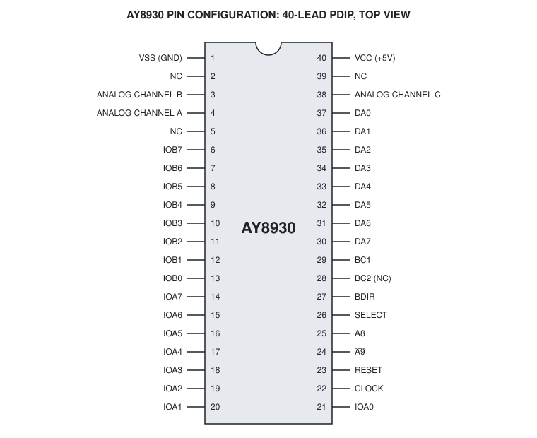

## Pin Functions

| Pin | Name | Type | Function |
|:---:|---|:---:|---|
| 1 | VSS | - | Ground reference. |
| 2, 5, 39 | NC | - | Test pins. Leave them open, do not use them as tie points. |
| 3, 4, 38 | ANALOG CHANNEL B, A, C | O | Outputs of the D/A converters, 1 V peak-to-peak maximum. |
| 6-13 | IOB7-IOB0 | I/O | I/O port B, 8 bits, with pull-up resistors. |
| 14-21 | IOA7-IOA0 | I/O | I/O port A, 8 bits, with pull-up resistors. |
| 22 | CLOCK | I | Clock input, TTL compatible. It drives the tone, noise and envelope generators. |
| 23 | /RESET | I | Active low. Sets all registers to 0 and the chip to compatibility mode. On-chip pull-up resistor. |
| 24 | /A9 | I | Chip select, active low. On-chip pull-down resistor. |
| 25 | A8 | I | Chip select, active high. On-chip pull-up resistor. |
| 26 | /SELECT | I | Clock divider. Low: the input clock is divided by 2 (input up to 4 MHz). High or open: no division (input up to 2 MHz). On-chip pull-up resistor. |
| 27 | BDIR | I | Bus direction. |
| 28 | BC2 | - | Not connected. The chip operates as if BC2 is high. |
| 29 | BC1 | I | Bus control 1. |
| 30-37 | DA7-DA0 | I/O | Data / address bus, 8 bits, three-state. |
| 40 | VCC | - | +5 V supply. |

A slash before a pin name (/RESET, /A9, /SELECT) marks an active low signal. In this document, fCLK is the clock of the generators: the CLOCK input frequency, divided by 2 when /SELECT is low.

## Device Architecture

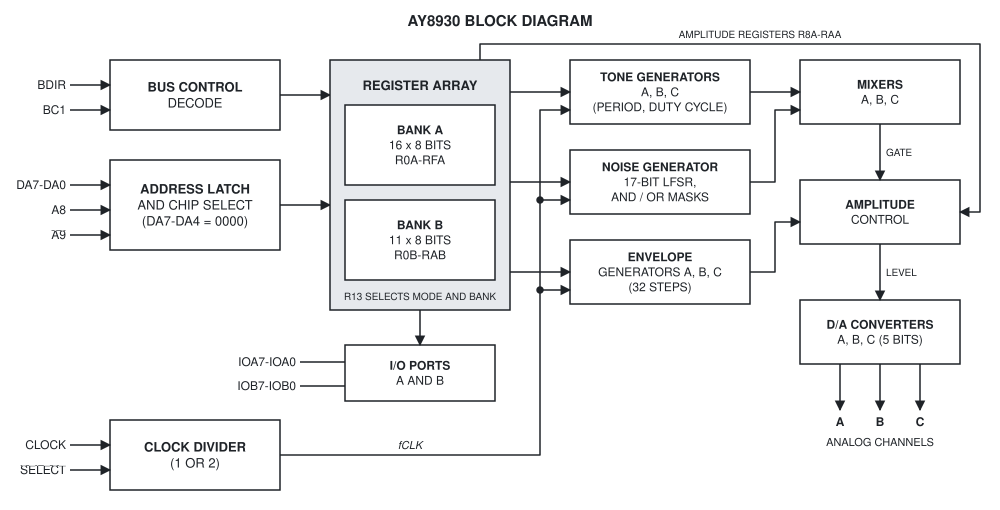

The AY8930 is a register-oriented sound generator. The processor controls the chip only through its registers: it latches a register address, then writes or reads the data. After the registers are written, the chip continues to make the sound without the processor.

| Block | Function |
|---|---|
| Tone generators | Make the pulse waves of channels A, B and C, with a programmable period and, in expanded mode, a programmable duty cycle. |
| Noise generator | Makes one pseudo-random pulse wave for all channels. |
| Mixers | Combine the tone and the noise of each channel into a gate signal. |
| Envelope generators | Make the amplitude patterns that modulate the channels. Expanded mode has one envelope generator per channel; compatibility mode uses envelope generator A for all channels. |
| Amplitude control | Gives each D/A converter either a fixed level from its amplitude register or the level of the envelope generator. |
| D/A converters | Convert the 5-bit level of each channel into a voltage, 32 logarithmic steps. |

## Bus Interface

### Input control signals

The AY8930 uses two of the three bus control lines of the AY-3-8910A: BDIR and BC1. The BC2 pin is not connected.

| BDIR | BC1 | Function |
|:---:|:---:|---|
| 0 | 0 | INACTIVE. The bus is not used, DA7-DA0 are in the high impedance state. |
| 0 | 1 | READ FROM PSG. The contents of the latched register go to DA7-DA0. |
| 1 | 0 | WRITE TO PSG. The data on DA7-DA0 is written to the latched register. |
| 1 | 1 | LATCH ADDRESS. The address on DA7-DA0 is latched. |

An inactive state is necessary between two active bus cycles.

### Register address and chip select

The registers occupy 16 addresses. The register address is the combination of DA7-DA0, A8 and /A9:

| /A9 | A8 | DA7 | DA6 | DA5 | DA4 | DA3 | DA2 | DA1 | DA0 |
|:---:|:---:|:---:|:---:|:---:|:---:|:---:|:---:|:---:|:---:|
| 0 | 1 | 0 | 0 | 0 | 0 | x | x | x | x |

- **DA3-DA0** select one of the 16 registers in the current bank.
- **DA7-DA4, A8, /A9** are chip select bits. The address enable code of DA7-DA4 is 0000 on all chips shipped. If the latched address has another code, the chip is deselected: it ignores the next data writes, and in a read cycle it keeps DA7-DA0 in the high impedance state. The chip is selected again by the next address latch cycle with the correct code.

> [!NOTE]
> An address such as 16h does not select register R6B. Register R6B is address 6 after a switch to bank B (see [Register banks](#register-banks)). A write to address 16h is ignored by the chip.

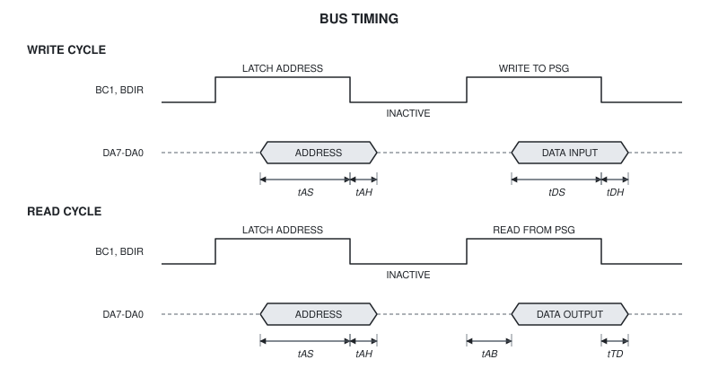

## Register Array

The AY8930 has 27 registers: bank A with 16 registers and bank B with 11 registers. Both banks use the same 16 addresses.

### Modes of operation

Register RD (register 13, the envelope shape register of channel A) also holds the mode select code in bits B7-B5 and, in expanded mode, the bank select bit B4:

| B7 | B6 | B5 | B4 | B3 | B2 | B1 | B0 |
|:---:|:---:|:---:|:---:|:---:|:---:|:---:|:---:|
| 1 | 0 | 1 | BANK | CONT. | ATT. | ALT. | HOLD |

- **B7-B5 = 101** selects the expanded mode. Any other code selects the compatibility mode.
- **B4** (expanded mode only) selects bank A (0) or bank B (1).
- **B3-B0** are the shape / cycle bits of envelope generator A.

So, 1010 SSSS selects the expanded mode with bank A, and 1011 SSSS selects the expanded mode with bank B (SSSS is the envelope shape).

> [!CAUTION]
> Each write of RD loads the envelope shape of channel A, so it restarts envelope generator A. This is also true for a write that only switches the bank, and for a write of the same value.

> [!CAUTION]
> AY-3-8910 software that writes RD with 1010 or 1011 in bits B7-B4 switches the AY8930 to the expanded mode.

### Mode switching

A switch between the compatibility mode and the expanded mode clears the registers:

- R0-RC of bank A and R0B-RAB of bank B are set to 0. The tone, noise and envelope periods, the amplitudes, the mixer, the duty cycles and the noise masks go to 0; envelope generators B and C restart with shape 0000.
- RD keeps the written value: its mode code, bank bit and the shape of envelope A, which restarts.
- The I/O port registers RE and RF keep their values.

A write of RD that keeps the mode (for example a bank switch from 1010 to 1011, or a write in compatibility mode with another code than 101) does not clear the registers.

> [!NOTE]
> Because the switch clears the registers, write RD first and then the other registers.

### Register banks

In expanded mode, bit B4 of RD selects which bank the addresses 0-Fh access. RD is at address Dh in both banks: it is one physical register.

### Register map: AY-3-8910A compatibility mode

| Reg. | Function | B7 | B6 | B5 | B4 | B3 | B2 | B1 | B0 |
|:---:|---|:---:|:---:|:---:|:---:|:---:|:---:|:---:|:---:|
| R0 | Channel A tone period, fine tune | 8-bit fine tune |||||||
| R1 | Channel A tone period, coarse tune | - | - | - | - | 4-bit coarse tune ||||
| R2 | Channel B tone period, fine tune | 8-bit fine tune |||||||
| R3 | Channel B tone period, coarse tune | - | - | - | - | 4-bit coarse tune ||||
| R4 | Channel C tone period, fine tune | 8-bit fine tune |||||||
| R5 | Channel C tone period, coarse tune | - | - | - | - | 4-bit coarse tune ||||
| R6 | Noise period | - | - | - | 5-bit period control |||||
| R7 | Enable (inverted) | IOB | IOA | Noise C | Noise B | Noise A | Tone C | Tone B | Tone A |
| R8 | Channel A amplitude | - | - | - | M | L4 | L3 | L2 | L1 |
| R9 | Channel B amplitude | - | - | - | M | L4 | L3 | L2 | L1 |
| RA | Channel C amplitude | - | - | - | M | L4 | L3 | L2 | L1 |
| RB | Envelope period, fine tune | 8-bit fine tune |||||||
| RC | Envelope period, coarse tune | 8-bit coarse tune |||||||
| RD | Envelope shape / cycle | Mode select ||| | CONT. | ATT. | ALT. | HOLD |
| RE | I/O port A data | 8-bit parallel I/O on port A |||||||
| RF | I/O port B data | 8-bit parallel I/O on port B |||||||

### Register map: expanded mode, bank A

| Reg. | Function | B7 | B6 | B5 | B4 | B3 | B2 | B1 | B0 |
|:---:|---|:---:|:---:|:---:|:---:|:---:|:---:|:---:|:---:|
| R0A | Channel A tone period, fine tune | 8-bit fine tune |||||||
| R1A | Channel A tone period, coarse tune | 8-bit coarse tune |||||||
| R2A | Channel B tone period, fine tune | 8-bit fine tune |||||||
| R3A | Channel B tone period, coarse tune | 8-bit coarse tune |||||||
| R4A | Channel C tone period, fine tune | 8-bit fine tune |||||||
| R5A | Channel C tone period, coarse tune | 8-bit coarse tune |||||||
| R6A | Noise period | 8-bit noise period |||||||
| R7A | Enable (inverted) | IOB | IOA | Noise C | Noise B | Noise A | Tone C | Tone B | Tone A |
| R8A | Channel A amplitude | - | - | M | L4 | L3 | L2 | L1 | L0 |
| R9A | Channel B amplitude | - | - | M | L4 | L3 | L2 | L1 | L0 |
| RAA | Channel C amplitude | - | - | M | L4 | L3 | L2 | L1 | L0 |
| RBA | Envelope A period, fine tune | 8-bit fine tune |||||||
| RCA | Envelope A period, coarse tune | 8-bit coarse tune |||||||
| RDA | Mode, bank, envelope A shape | 1 | 0 | 1 | 0 | CONT. | ATT. | ALT. | HOLD |
| REA | I/O port A data | 8-bit parallel I/O on port A |||||||
| RFA | I/O port B data | 8-bit parallel I/O on port B |||||||

### Register map: expanded mode, bank B

| Reg. | Function | B7 | B6 | B5 | B4 | B3 | B2 | B1 | B0 |
|:---:|---|:---:|:---:|:---:|:---:|:---:|:---:|:---:|:---:|
| R0B | Envelope B period, fine tune | 8-bit fine tune |||||||
| R1B | Envelope B period, coarse tune | 8-bit coarse tune |||||||
| R2B | Envelope C period, fine tune | 8-bit fine tune |||||||
| R3B | Envelope C period, coarse tune | 8-bit coarse tune |||||||
| R4B | Envelope B shape / cycle | - | - | - | - | CONT. | ATT. | ALT. | HOLD |
| R5B | Envelope C shape / cycle | - | - | - | - | CONT. | ATT. | ALT. | HOLD |
| R6B | Channel A duty cycle | - | - | - | - | 4-bit duty cycle ||||
| R7B | Channel B duty cycle | - | - | - | - | 4-bit duty cycle ||||
| R8B | Channel C duty cycle | - | - | - | - | 4-bit duty cycle ||||
| R9B | Noise AND mask | 8-bit AND mask |||||||
| RAB | Noise OR mask | 8-bit OR mask |||||||
| RBB | Reserved | Not accessible |||||||
| RCB | Reserved | Not accessible |||||||
| RDB | Mode, bank, envelope A shape | 1 | 0 | 1 | 1 | CONT. | ATT. | ALT. | HOLD |
| REB | Reserved | Not accessible |||||||
| RFB | Test | Not to be accessed by the user |||||||

"-" marks bits without function. Writes to the reserved registers have no effect, and the reserved registers read as 0.

### Software register numbering

Most software that keeps the state of an AY8930 uses one flat register map with 32 numbers instead of the two banks: 00h-0Fh for bank A and 10h-1Ah for R0B-RAB (1Dh is the same register as 0Dh). psg-tools (frames and PSG files), MAME and Furnace use this numbering internally. A flat number from 10h is not a chip address: before a write to the chip, the software must switch to bank B through RD and write the address of the register in the bank (see [Updates of both banks](#updates-of-both-banks)).

## Sound Generating Blocks

| Operation | Registers (expanded mode) | Function |
|---|---|---|
| Tone generator control | R0A-R5A | Program the tone periods. |
| Duty cycle control | R6B-R8B | Select the duty cycles. |
| Noise generator control | R6A, R9B, RAB | Program the noise period and the noise masks. |
| Mixer control | R7A | Enable tone and / or noise on each channel. |
| Amplitude control | R8A-RAA | Select a fixed or an envelope controlled amplitude. |
| Envelope generator control | RBA-RDA, R0B-R5B | Program the envelope periods and patterns. |
| D/A converters | - | Make the analog output of each channel. |

All the generators count at fCLK / 8. All period values work the same way:

- A period value of 0 has the same effect as 1.
- A new period value takes effect at once. The counter of the generator continues to count and is compared with the new value; if the counter has already passed the new value, the next output change comes at the next count. The counter is not reloaded only at the end of the current period.

## Tone Generator Control

Each channel has a tone period of two registers, coarse tune and fine tune. The tone period value TP is a period: the higher the value, the lower the frequency.

| Channel | Coarse tune | Fine tune |
|:---:|:---:|:---:|
| A | R1 / R1A | R0 / R0A |
| B | R3 / R3A | R2 / R2A |
| C | R5 / R5A | R4 / R4A |

### Compatibility mode: 12-bit tone period

TP is 12 bits: TP11-TP8 are bits B3-B0 of the coarse tune register, TP7-TP0 are the fine tune register. The tone generator gives a square wave (50 % duty cycle):

**fT = fCLK / (16 x TP)**

### Expanded mode: 16-bit tone period

TP is 16 bits: TP15-TP8 are the coarse tune register, TP7-TP0 are the fine tune register. The tone generator divides one tone period into 32 duty steps, and the duty cycle register sets how many steps are high (see [Duty Cycle Control](#duty-cycle-control)):

**fT = fCLK / (8 x TP)**

For the same TP value, the tone in expanded mode is one octave higher than in compatibility mode.

| fCLK | Mode | TP range | Frequency range |
|:---:|:---:|:---:|:---:|
| 1.7734 MHz | Compatibility | 1-4095 | 110.8 kHz - 27.07 Hz |
| 1.7734 MHz | Expanded | 1-65535 | 221.7 kHz - 3.38 Hz |
| 2.0 MHz | Compatibility | 1-4095 | 125.0 kHz - 30.53 Hz |
| 2.0 MHz | Expanded | 1-65535 | 250.0 kHz - 3.81 Hz |

## Duty Cycle Control

In expanded mode, the duty cycle of each tone generator is set by a 4-bit duty cycle register: R6B for channel A, R7B for channel B, R8B for channel C. The percent is the high part of one tone period.

| Register value | Duty cycle | High steps of 32 |
|:---:|:---:|:---:|
| 0000 | 3.125 % | 1 |
| 0001 | 6.25 % | 2 |
| 0010 | 12.5 % | 4 |
| 0011 | 25 % | 8 |
| 0100 | 50 % | 16 |
| 0101 | 75 % | 24 |
| 0110 | 87.5 % | 28 |
| 0111 | 93.75 % | 30 |
| 1000 | 96.875 % | 31 |

Values from 1000 to 1111 all give 96.875 %. The value 0000 after reset and after a mode switch gives 3.125 %, not 50 %: set the duty cycle registers after the switch to expanded mode.

A new duty cycle value takes effect at once, at the current step of the period. The period in which the register is written can have an intermediate duty cycle.

In compatibility mode, the duty cycle is always 50 %.

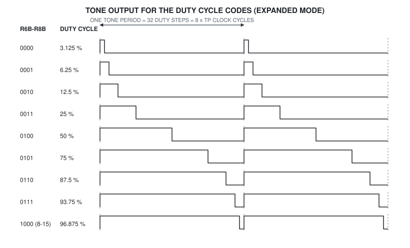

## Noise Generator Control

The noise generator is a 17-bit shift register that shifts right. The new bit B16 is B0 XOR B2 in both modes.

### Compatibility mode

The noise period value NP is bits B4-B0 of R6 (1 to 31). The shift register shifts once for each 2 x NP counts of fCLK / 8, and the noise output is bit B0:

**fSHIFT = fCLK / (16 x NP)**

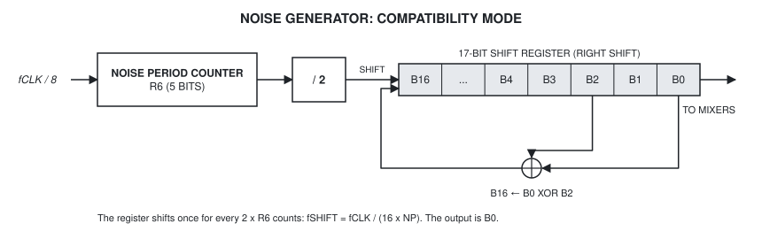

> [!NOTE]
> The feedback of the AY-3-8910 is B0 XOR B3. The AY8930 gives another noise sequence than the AY-3-8910 also in compatibility mode.

### Expanded mode

In expanded mode, the noise generator has three parts: the 8-bit noise period counter (R6A), the noise value counter and the output flip-flop.

1. The noise period counter counts at fCLK / 8. Each NP counts (NP = R6A, 1 to 255), it gives one count to the noise value counter.
2. The noise value counter counts up and is compared with the value **V = (B7-B0 of the shift register AND R9B) OR RAB**.
3. When the noise value counter reaches V, the counter is cleared, the output flip-flop toggles and the shift register shifts once.

So the output stays at one level for max(V, 1) counts of the noise period counter, and the length of each level comes from the shift register:

**t(level) = 8 x NP x max(V, 1) / fCLK**

The masks change the noise at once: the comparison always uses the current values of R9B and RAB.

| R9B (AND) | RAB (OR) | Noise output |
|:---:|:---:|---|
| FFh | 00h | Pulse lengths of 1 to 255 counts, random: the widest noise. |
| 0Fh | 00h | Pulse lengths of 1 to 15 counts: higher, brighter noise. |
| F0h | 00h | Pulse lengths of 1 or 16 to 240 counts: lower noise. |
| 00h | n | A square wave, each level n counts long: fT = fCLK / (16 x NP x max(n, 1)). |
| other | other | The bits set in RAB are always set in V, the bits cleared in R9B are always cleared. |

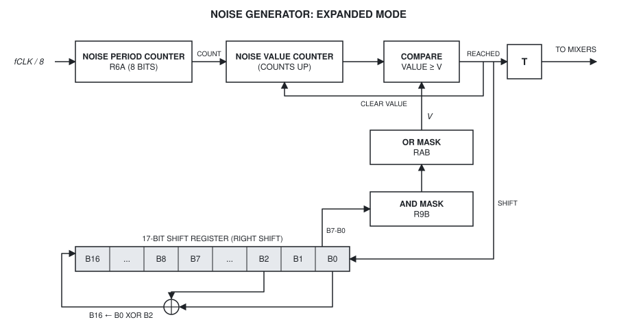

## Mixer Control - I/O Enable

Register R7 (R7A) is a multi-function register: it enables the tone and the noise of each channel, and it sets the direction of the two I/O ports. A bit value of 0 enables the tone or the noise. The register has the same function in both modes.

| Bit | B7 | B6 | B5 | B4 | B3 | B2 | B1 | B0 |
|---|:---:|:---:|:---:|:---:|:---:|:---:|:---:|:---:|
| Function | IOB direction | IOA direction | Noise C | Noise B | Noise A | Tone C | Tone B | Tone A |
| 0 | Input | Input | Enabled | Enabled | Enabled | Enabled | Enabled | Enabled |
| 1 | Output | Output | Disabled | Disabled | Disabled | Disabled | Disabled | Disabled |

The mixer of each channel gives a gate signal. When the gate is 1, the D/A converter of the channel gets its amplitude (fixed or envelope). When the gate is 0, the D/A converter gets level 0. **The AY8930 mixer is an OR of the enabled sources, in both modes:**

**GATE = (TONE AND tone enabled) OR (NOISE AND noise enabled)**

| Tone | Noise | Gate on the AY8930 | Gate on the AY-3-8910 |
|:---:|:---:|---|---|
| Enabled | Disabled | Tone | Tone |
| Disabled | Enabled | Noise | Noise |
| Enabled | Enabled | Tone OR noise | Tone AND noise |
| Disabled | Disabled | **0: the channel is silent** | 1: the channel gives its amplitude |

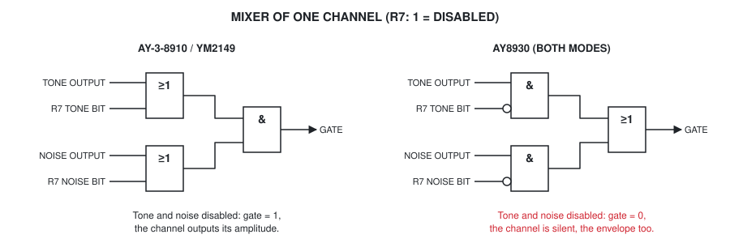

> [!CAUTION]
> With tone and noise both disabled, the channel is silent, also when its amplitude comes from the envelope generator. To play an envelope alone, see [Pure envelope output](#pure-envelope-output).

## Amplitude Control

The amplitude of each channel is set by its amplitude register: R8 (R8A) for channel A, R9 (R9A) for channel B, RA (RAA) for channel C. Bit M selects the source of the level:

- **M = 0:** fixed level, from bits L4-L0 of the register.
- **M = 1:** variable level, from the 5-bit output of the envelope generator. Bits L4-L0 have no effect.

### Compatibility mode

| B7 | B6 | B5 | B4 | B3 | B2 | B1 | B0 |
|:---:|:---:|:---:|:---:|:---:|:---:|:---:|:---:|
| - | - | - | M | L4 | L3 | L2 | L1 |

The fixed level has 16 values: bits B3-B0 give L4-L1, and L0 is always 1. The fixed level 0 gives D/A level 1, which is silent (see [Digital to Analog Converter](#digital-to-analog-converter)).

### Expanded mode

| B7 | B6 | B5 | B4 | B3 | B2 | B1 | B0 |
|:---:|:---:|:---:|:---:|:---:|:---:|:---:|:---:|
| - | - | M | L4 | L3 | L2 | L1 | L0 |

The fixed level has 32 values, from 0 (silent) to 31.

## Envelope Generator Control

### Envelope period

Each envelope generator has a 16-bit envelope period value EP (1 to 65535). In compatibility mode, envelope generator A is the only one, and all channels use it. In expanded mode, each channel has its own envelope generator.

| Envelope | Used by | Coarse tune | Fine tune | Shape / cycle |
|:---:|---|:---:|:---:|:---:|
| A | Channel A (all channels in compatibility mode) | RC / RCA | RB / RBA | RD / RDA |
| B | Channel B, expanded mode | R1B | R0B | R4B |
| C | Channel C, expanded mode | R3B | R2B | R5B |

The envelope generator steps once for each EP counts of fCLK / 8, and one cycle of the envelope has 32 steps, in both modes:

**fE = fCLK / (256 x EP)**

| fCLK | EP range | Envelope cycle frequency |
|:---:|:---:|:---:|
| 1.7734 MHz | 1-65535 | 6927 Hz - 0.106 Hz |
| 2.0 MHz | 1-65535 | 7813 Hz - 0.119 Hz |

### Envelope shape / cycle

Bits B3-B0 of the shape / cycle register (RD, R4B, R5B) set the pattern of the envelope. Bits B7-B4 of R4B and R5B have no function; bits B7-B4 of RD are the mode and bank bits.

- **CONT. (continue):** 0 - after one cycle, the level goes to 0 and holds. 1 - the pattern is set by HOLD.
- **ATT. (attack):** 0 - the first cycle counts down from 31 to 0. 1 - the first cycle counts up from 0 to 31.
- **ALT. (alternate):** 1 - the count direction reverses after each cycle.
- **HOLD:** 1 - after one cycle, the level holds. With ALT. = 1, the level holds at the opposite end (the end of a reversed cycle).

Loading the shape / cycle register restarts the envelope generator: the level goes to the start of the pattern, and the envelope period counter is cleared. A write of the same value also restarts it. For envelope A, each write of RD is a load, also a write that only switches the bank.

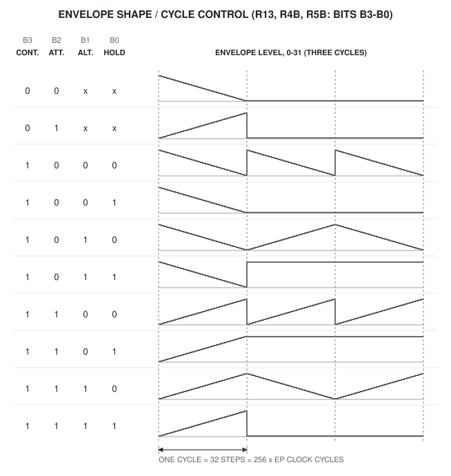

The level of the envelope generator has 32 steps (E4-E0). In expanded mode, all 32 levels go to the D/A converter. In compatibility mode, E0 is always 1, so the envelope gives 16 levels with the same cycle time as the AY-3-8910 envelope.

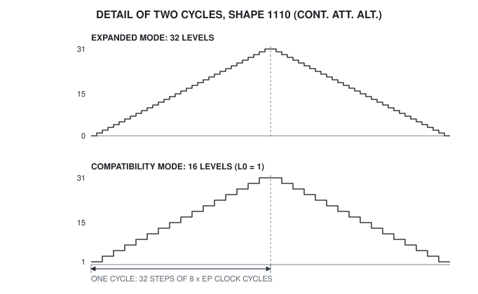

## Digital to Analog Converter

Each channel has a 5-bit D/A converter with a logarithmic output, 32 levels from 0 V to 1 V (normalized). Level 0 gives no current. The figure shows the levels of the psg-tools emulation, which uses the measured levels of the YM2149 (also a 32-level converter), and the nominal curve of DS50010C with 1.5 dB per level.

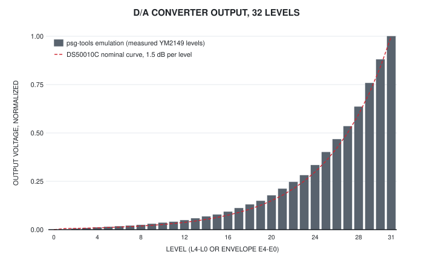

| Level | Output | Level | Output | Level | Output | Level | Output |
|:---:|:---:|:---:|:---:|:---:|:---:|:---:|:---:|
| 0 | 0.0000 | 8 | 0.0244 | 16 | 0.0925 | 24 | 0.3337 |
| 1 | 0.0000 | 9 | 0.0297 | 17 | 0.1111 | 25 | 0.4004 |
| 2 | 0.0047 | 10 | 0.0351 | 18 | 0.1297 | 26 | 0.4674 |
| 3 | 0.0077 | 11 | 0.0404 | 19 | 0.1485 | 27 | 0.5344 |
| 4 | 0.0110 | 12 | 0.0485 | 20 | 0.1767 | 28 | 0.6352 |
| 5 | 0.0140 | 13 | 0.0583 | 21 | 0.2116 | 29 | 0.7580 |
| 6 | 0.0170 | 14 | 0.0681 | 22 | 0.2464 | 30 | 0.8799 |
| 7 | 0.0200 | 15 | 0.0778 | 23 | 0.2811 | 31 | 1.0000 |

> [!NOTE]
> The D/A levels of the AY8930 itself have not been measured. The YM2149 table is the best known match; it is also what MAME uses for the AY8930.

## I/O Port Data Store

Registers RE and RF (REA and RFA) are intermediate data stores between the bus DA7-DA0 and the I/O ports IOA7-IOA0 and IOB7-IOB0. They have no effect on the sound. The direction of each port is set by bits B6 (port A) and B7 (port B) of R7: 1 is output, 0 is input.

To output data on port A: write R7 with B6 = 1, then write the data to RE. The data goes through RE to the port pins.

To input data from port A: write R7 with B6 = 0, then read RE. The register follows the signals on the port pins.

The port pins have pull-up resistors. A 1 written to a port bit that is pulled low from outside reads back as 0. A 0 written to an output bit that is driven high from outside causes a conflict between the pull-down transistor and the external driver.

The I/O ports are available in both modes and keep their data at a mode switch.

## Reset and Register Read-Back

### Reset

A low level on /RESET for at least two clock periods:

- sets all the registers of both banks to 0, so the chip is in compatibility mode with bank A;
- clears the tone, noise and envelope counters;
- sets the noise shift register to 1 (only bit B0 set).

> [!NOTE]
> DS50010C states that reset sets the noise shift register to all ones. psg-tools and MAME start it at 1. The difference changes only the first noise values after reset.

### Register read-back

A read cycle returns the contents of the latched register in the current bank.

- A register returns the last value written to it, with all 8 bits. Do not depend on the bits without function: DS50010C states that they read as 0, which has not been confirmed.
- The reserved registers of bank B (RBB, RCB, REB) read as 0.
- RD returns the same value in both banks.
- When the chip is deselected (see [Register address and chip select](#register-address-and-chip-select)), DA7-DA0 stay in the high impedance state; a bus with pull-up resistors reads FFh.

## Electrical Characteristics

### Maximum ratings*

| Parameter | Rating |
|---|---|
| Storage temperature | -55 °C to +150 °C |
| Maximum temperature under bias | +125 °C |
| VDD and all other input / output voltages with respect to VSS | -0.3 V to +7.0 V |

\* Exceeding these ratings can cause permanent damage to the device. This is a stress rating only; operation of the device at these conditions is not implied. Exposure to maximum ratings for extended periods can affect device reliability.

### Standard conditions (unless otherwise noted)

| Parameter | Value |
|---|---|
| Free air operating temperature | 0 °C to +70 °C |
| VDD | +4.5 V to +5.5 V |
| VSS | 0.0 V (ground) |

### DC characteristics

| Parameter | Symbol | Min | Typ | Max | Units | Conditions |
|---|:---:|:---:|:---:|:---:|:---:|---|
| Input logic 0 | VIL | -0.3 | - | +0.4 | V | |
| Input logic 1 | VIH | +2.4 | - | VDD | V | |
| Input leakage: CLOCK | - | - | - | 10 | µA | |
| Input leakage: BC1, BDIR | - | - | - | 10 | µA | |
| Inputs with pull-ups: A8, RESET, SELECT | IIL | 10 | - | 100 | µA | VIN = +0.4 V |
| Inputs with pull-downs: A9 | IIH | 10 | - | 50 | µA | VIN = +2.4 V |
| I/O with pull-ups: IOA7-IOA0, IOB7-IOB0 | IIL | 20 | - | 150 | µA | VIN = +0.4 V |
| | VOH | +2.4 | - | VDD | V | IOH = 100 µA, 100 pF |
| | VOL | 0.0 | - | +0.4 | V | IOL = 1.6 mA, 100 pF |
| Data / address DA7-DA0 | VOH | +2.4 | - | VDD | V | IOH = 100 µA, 100 pF |
| | VOL | 0.0 | - | +0.4 | V | IOL = 1.6 mA, 100 pF |
| Power supply | IDD | - | - | 85 | mA | All inputs and outputs tied to VSS or VDD |
| Analog output | - | - | - | 1.0 | V p-p | Each channel |

### AC characteristics

| Parameter | Symbol | Min | Typ | Max | Units | Conditions |
|---|:---:|:---:|:---:|:---:|:---:|---|
| Clock input frequency | - | 1 | - | 4 | MHz | 40/60 asymmetry allowed; 2 MHz maximum when SELECT is high |
| Clock rise / fall time | tR, tF | 0 | - | 50 | ns | |
| Master reset pulse | tRS | 2 clock periods | - | - | - | |
| Control signals BC1, BC2, BDIR: skew | tCS | - | - | 40 | ns | |
| Control signals: valid | tCCS | 300 | - | - | ns | |
| Address setup time (DA7-DA0, A8, A9) | tAS | 300 | - | - | ns | |
| Address hold time | tAH | 65 | - | - | ns | |
| Read: data access time | tAB | - | - | 200 | ns | |
| Read: data hold time | tTD | 20 | - | 100 | ns | |
| Write: data setup time | tDS | 300 | - | - | ns | |
| Write: data hold time | tDH | 65 | - | - | ns | |
| I/O port output: data setup time | tPW | 500 | - | - | ns | |
| I/O port input: data setup time | tPRS | 200 | - | - | ns | |
| I/O port input: data hold time | tPRH | 65 | - | - | ns | |

A read or write cycle is an address latch, an inactive state, then the read or write command. An inactive state is necessary between two active commands (see the [bus timing](#register-address-and-chip-select) figure).

## Application Information

### Initialization for expanded mode

1. Write RD = 1010 SSSS. The chip goes to expanded mode with bank A and clears all the registers.
2. Write the bank A registers: tone periods, noise period, mixer, amplitudes, envelope A period.
3. Write RD = 1011 SSSS (bank B), then write R0B-RAB: envelope B and C periods and shapes, duty cycles, noise masks. Set the noise masks: with R9B = RAB = 0, V is always 0 and the noise output toggles at each count of the noise period counter.
4. Write RD = 1010 SSSS to go back to bank A.

The writes of RD in steps 1, 3 and 4 restart envelope A.

### Updates of both banks

A music player usually writes the changed registers once per frame (50 or 60 Hz). Because each write of RD restarts envelope A, use this order for one update, as the psg-tools player does (`ChipBus::Send`):

1. If the mode changes: RD first (the switch clears the registers), and then all registers.
2. The changed registers of bank A, without RD.
3. If registers of bank B changed: RD with the bank B bit, then the changed registers of bank B.
4. RD last, if it changed or if the bank must go back to A. Envelope A restarts after its period is set, as on the AY-3-8910.

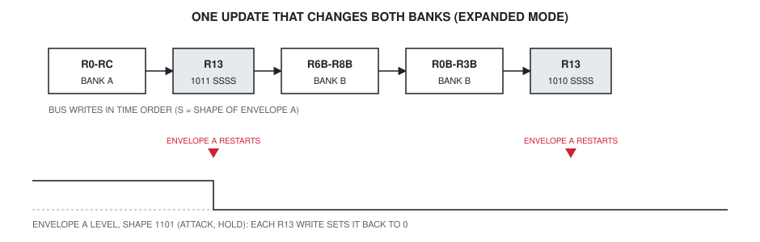

Recommendations:

- Write bank B only when its registers change: each bank switch restarts envelope A.
- For a continuous periodic envelope (for example an envelope bass) in a piece that changes the duty cycles or the noise masks often, use envelope B or C. Their restarts depend only on writes of R4B and R5B.

### Pure envelope output

On the AY8930, a channel with tone and noise disabled is silent (see [Mixer Control](#mixer-control---io-enable)). To play the envelope alone on a channel, as the AY-3-8910 does with tone and noise disabled, enable the tone of the channel at the highest frequency instead (psg-tools does this in `AY8930EnvelopeFix`):

- tone period TP = 0;
- duty cycle 1000 (96.875 %), in expanded mode;
- tone enabled in R7, noise disabled.

In expanded mode, the gate is then 1 for 31 of the 32 duty steps of a tone at fCLK / 8, far above the audible range, so the output is practically the envelope. In compatibility mode, the tone is a 50 % square wave at fCLK / 16 (110.8 kHz at 1.7734 MHz); after the low-pass filter of the audio stage, the output is the envelope at about half amplitude.

### Noise generator as a square wave

With R9B = 00h and RAB = n, the noise generator gives a square wave with fN = fCLK / (16 x NP x max(n, 1)). With other masks, the length of each level is random, but it stays inside the range that the masks allow. A music driver can use this for buzz and percussion sounds with a defined pitch range.

### Software for the AY-3-8910 in compatibility mode

The compatibility mode runs most AY-3-8910 software, but these differences can be audible:

| Difference | Effect | Remedy |
|---|---|---|
| OR mixer | A channel with tone and noise disabled is silent, also with the envelope. A channel with tone and noise enabled gives tone OR noise instead of tone AND noise. | Use the [pure envelope output](#pure-envelope-output) for envelope-only channels. |
| Noise feedback B0 XOR B2 | Another noise sequence and timbre. | None. |
| Mode code in RD | Bits B7-B5 = 101 select the expanded mode and clear the registers. | Write RD with 0000 in bits B7-B4. |

### Register logs and file formats

A log of the register writes (VGM, PSG and other formats) can keep the bank B registers in two ways:

- **As bus writes:** RD with the bank bit, then addresses 0-Ch. This is what the chip accepts, and what Furnace Tracker writes to VGM files.
- **As flat numbers 10h-1Ah:** the [software register numbering](#software-register-numbering). PSG files and the psg-tools VGM encoder use this.

A player that sends a log to a real chip must convert flat numbers to bus writes: the chip ignores addresses from 10h. psg-tools reads both forms (`ChipBus::Receive`).

## Differences from DS50010C

This document follows psg-tools first, MAME second and DS50010C last. These are the points where it differs from DS50010C:

| Subject | DS50010C | This document | Source |
|---|---|---|---|
| Tone frequency, expanded mode | Period of output = 16 x TP x P | fT = fCLK / (8 x TP): one octave higher than compatibility mode at the same TP | psg-tools (checked by ear against the chip), Furnace hardware tests (PR #416) |
| Mixer | Disabling tone and noise does not turn off a channel | OR mixer: a channel with tone and noise disabled is silent, in both modes | psg-tools, checked on the chip; MAME and Furnace use the AY-3-8910 rule |
| Mode switch | All registers are initialized except the mode select code of RD | R0-RC and R0B-RAB are cleared; RD keeps the written value; RE and RF keep their values | MAME, psg-tools |
| Bank switch | Not described | Each write of RD, a bank switch too, restarts envelope A | DS50010C rule for loads of the shape register; MAME, psg-tools |
| Period changes | Tone counter reloads at zero; envelope period changes at the period boundary | A new period takes effect at once, compared with the running counter | psg-tools, MAME |
| Expanded noise | The noise value is loaded from the masks and counts down | The noise value counter counts up and is compared with the masked value; mask changes take effect at once | psg-tools, MAME, Furnace |
| Noise shift register after reset | All ones | 1 | psg-tools, MAME |
| Read-back of bits without function | Read as 0 | Return the written value (not confirmed on the chip) | psg-tools, MAME |
| D/A levels | Nominal curve, 1.5 dB per level | YM2149 measured levels | psg-tools, MAME |
| Fixed level 0 in compatibility mode | L0 forced to 1: level 1 of 31 | Same; D/A levels 0 and 1 are both silent | DS50010C, psg-tools |

## References

1. **psg-tools**, this repository. The behavior of the chip in this document comes from:
   - [`emulation/AY89XXPsg.cpp`](../psg-tools/psg_audio/sources/emulation/AY89XXPsg.cpp): the AY8930 emulator (tone, duty, noise, mixer, envelopes, D/A levels, mode switch, bus);
   - [`stream/ChipBus.cpp`](../psg-tools/psg_audio/sources/stream/ChipBus.cpp): the conversion between flat register numbers and bus writes, and the order of the writes;
   - [`processing/AY8930EnvelopeFix.h`](../psg-tools/psg_audio/sources/processing/AY8930EnvelopeFix.h): the pure envelope output;
   - [`stream/Frame.cpp`](../psg-tools/psg_audio/sources/stream/Frame.cpp): the flat register map;
   - the AYM Streamer output, which plays the AY8930 on real chips.
2. **MAME**, `src/devices/sound/ay8910.cpp`: the AY8930 emulation (mode switch, chip select, LFSR, expanded noise). https://github.com/mamedev/mame
3. **Furnace Tracker**, AY8930 emulation tested on the hardware of the Darky MSX card; pull request #416 (tone and noise periods in expanded mode); `src/engine/platform/ay8930.cpp` (bank switching driver). https://github.com/tildearrow/furnace
4. **Microchip Technology Inc.**, *AY8930 Enhanced Programmable Sound Generator*, DS50010C, 1990.
5. **laurentd75/AY-3-8930-Arduino-Test**: a bank switching driver for the AY8930 on an Arduino. https://github.com/laurentd75/AY-3-8930-Arduino-Test

The figures are made by [`AY8930/make_figures.py`](AY8930/make_figures.py) from the same rules as the psg-tools emulator. Each figure holds the colors of the light and the dark theme and selects them with `prefers-color-scheme`.

---

*AY8930 is a product of Microchip Technology Inc. This revised datasheet is an independent document of the psg-tools project and is not published or approved by Microchip.*
